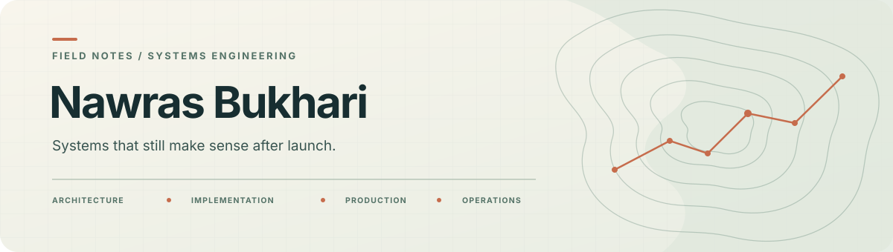

  

   

  
  
  

  <strong>Systems architect · Software engineer · Scientific researcher</strong> 
  I build production software across backend platforms, computer vision, cybersecurity, and infrastructure.

<h2 align="center">Selected work</h2>

<table>
  <tr>
    <td width="50%" valign="top">
      <h3>🚘 <a href="https://nbukhari.dev/work/avtosan">Avtosan</a></h3>
      
Production vehicle assessment: document analysis, OCR, VIN validation, market pricing, and bank-ready reports.

    </td>
    <td width="50%" valign="top">
      <h3>👁️ <a href="https://nbukhari.dev/work/fire-smoke-intelligence">SkyVision</a></h3>
      
Desktop video intelligence with detection, tracking, local semantic analysis, and operator-defined monitoring.

    </td>
  </tr>
  <tr>
    <td width="50%" valign="top">
      <h3>🦌 <a href="https://nbukhari.dev/work/saiga-vision">SaigaVision</a></h3>
      
Aerial wildlife monitoring that connects observability, detection, tracking, and geolocation while keeping visible counts distinct from population estimates.

    </td>
    <td width="50%" valign="top">
      <h3>🚁 <a href="https://nbukhari.dev/work/uav-resilient-field-systems">UAV field systems</a></h3>
      
Telemetry architecture with validation before persistence and separate observation and command paths.

    </td>
  </tr>
</table>

<a href="https://nbukhari.dev/#work">Explore all work →</a>

<h2 align="center">Research</h2>

  <a href="https://nbukhari.dev/research/saiga-counting-metrology">Saiga counting: a metrological framework</a>
  &nbsp;·&nbsp;
  <a href="https://doi.org/10.37943/25GEVU5826">UAV telemetry cybersecurity architecture</a>
  &nbsp;·&nbsp;
  <a href="https://vestnik.alt.edu.kz/index.php/journal/article/view/3665">Machine learning for UAV control-channel security</a>

<h2 align="center">Technologies</h2>

  <strong>Backend</strong> · Python / FastAPI · PHP / Laravel 
  <strong>Frontend</strong> · Vue · React · TypeScript 
  <strong>Computer vision</strong> · C++ · Qt · OpenCV · FFmpeg · TensorRT · Core ML 
  <strong>Data &amp; infrastructure</strong> · PostgreSQL · Redis · SQLite · Docker · Nginx

  <a href="https://nbukhari.dev">Portfolio</a> &nbsp;·&nbsp;
  <a href="https://nbukhari.dev/#contact">Get in touch</a> &nbsp;·&nbsp;
  <a href="https://orcid.org/0009-0008-3682-2029">ORCID</a>

